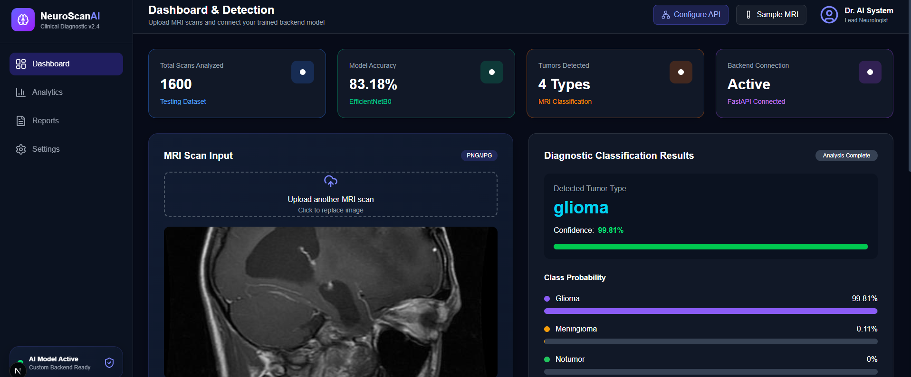

# 🧠 NeuroScanAI — Brain Tumor Classification System

NeuroScanAI is an AI-powered brain MRI classification system that uses deep learning to classify MRI scans into four brain tumor categories. It features a modern, responsive web dashboard where users can upload MRI images, view predicted tumor types, explore class probabilities, and visualize model predictions using Grad-CAM.

> ⚠️ **Medical Disclaimer:** This project is developed for educational and research purposes only. It is not intended to provide medical diagnosis or replace professional medical advice. Always consult a qualified healthcare professional for medical concerns.

**Dataset:** The model was trained using a brain MRI tumor classification dataset obtained from Kaggle. The dataset is not included in this repository.

## ✨ Features

- 📤 Upload brain MRI images in PNG/JPG format.
- 🧠 AI-powered brain tumor classification using **EfficientNetB0**.
- 📊 Softmax-based class probability visualization.
- 🎯 Display of predicted tumor category and confidence score.
- 🔥 **Grad-CAM visualization** to highlight image regions influencing the model's prediction.
- 📈 Interactive charts and analysis result visualizations.
- ⚡ FastAPI backend for model inference and image analysis.
- 🎨 Responsive dashboard built with Next.js, React, TypeScript, and Tailwind CSS.
- 🧩 Modular dashboard components for displaying predictions, metrics, and visual explanations.

## 🧬 Supported Classes

The model classifies MRI images into four categories:

- **Glioma**
- **Meningioma**
- **Pituitary**
- **NoTumor**

## 🛠️ Tech Stack

| Category | Technologies |
|---|---|
| Frontend | Next.js, React, TypeScript |
| Styling | Tailwind CSS |
| Backend | Python, FastAPI, Uvicorn |
| Deep Learning | TensorFlow / Keras, EfficientNetB0 |
| Image Processing | Pillow, NumPy |
| Explainable AI | Grad-CAM |
| Visualization | Interactive charts and dashboard components |
| API Communication | REST API |

## 🔄 How It Works

```text
MRI Image Upload
       ↓
Next.js + TypeScript Frontend
       ↓
FastAPI Backend
       ↓
Image Preprocessing
       ↓
EfficientNetB0 Model
       ↓
Softmax Class Probabilities
       ↓
Grad-CAM Visualization
       ↓
Prediction Results + Visual Explanation
       ↓
Interactive Dashboard
```

## 📊 Example Result

After uploading an MRI scan, the application displays the predicted tumor category, confidence score, class probabilities, and available Grad-CAM visualization.

Example output:

```text
Predicted Class: Pituitary
Confidence: 99.53%

Glioma       0.06%
Meningioma   0.37%
NoTumor      0.04%
Pituitary   99.53%
```

*Example values are illustrative and may differ depending on the input image and model output.*

## 🖥️ Application Preview


(screenshots/dashboard2.png)

## 🚀 Getting Started

### Prerequisites

- Python version compatible with the project's TensorFlow dependencies
- Node.js and npm
- Git

### 1. Clone the Repository

```bash
git clone https://github.com/Minahyl/brain-tumor-detection-system.git
cd brain-tumor-detection-system
```

### 2. Backend Setup

Create a virtual environment from the project root:

```powershell
python -m venv venv
```

Activate the environment in Windows PowerShell:

```powershell
.\venv\Scripts\Activate.ps1
```

Install the required Python packages:

```powershell
python -m pip install -r requirements.txt
```

Start the FastAPI backend:

```powershell
cd backend
python -m uvicorn main:app --reload
```

The backend will run at:

- **API:** http://127.0.0.1:8000
- **API Documentation:** http://127.0.0.1:8000/docs

### 3. Frontend Setup

Open a separate terminal and navigate to the frontend directory:

```powershell
cd frontend
npm install
npm run dev
```

Open the application in your browser:

http://localhost:3000

**Note:** Keep the backend running while using the application. Ensure the API URL configured in the frontend matches the backend address.

## 📁 Project Structure

```text
brain-tumor-detection/
├── backend/
│   ├── main.py
│   ├── gradcam.py
│   └── main_backup.py
├── frontend/
│   ├── app/
│   └── components/
├── dataset/
├── models/
├── notebooks/
├── outputs/
├── screenshots/
│   └── dashboard.png
├── src/
├── requirements.txt
└── README.md
```

## 📚 Dataset & Model

The project uses an EfficientNetB0-based deep learning model trained on a brain MRI tumor classification dataset obtained from Kaggle.

The dataset is not included in this repository. Model predictions and probability scores depend on the model, training data, preprocessing, and input image quality.

## 📌 Project Status

**Completed Working Prototype**

NeuroScanAI provides a complete working prototype for brain MRI image upload, deep learning-based classification, prediction probability visualization, and Grad-CAM-based visual explanations through a modern web dashboard.

## 👩‍💻 Author

**Minahil Shah**
